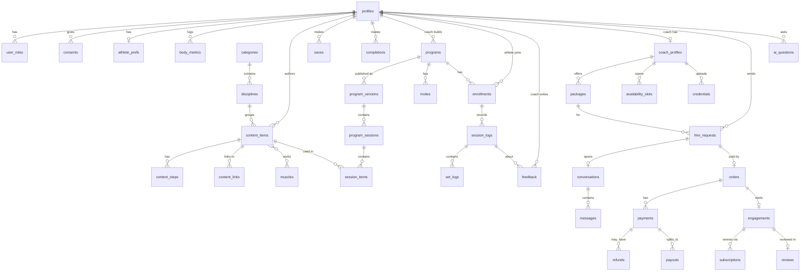

# FitSphere v1: Architecture

Status: **Approved 2026-11-05** (owner: "use the best stack you recommend; it must scale to more categories and features"). Items marked *Decision* are open; the rest follows from the approved design doc.

## 1. Shape of the system

One web app, one database. No microservices.

| Layer | Proposal | Why | Decision |
|---|---|---|---|
| Frontend | Next.js App Router, React Server Components, TypeScript strict | Pages render on the server (fast on cheap phones); one codebase for UI and server logic | Approved |
| Server logic | Server Actions for user actions; Route Handlers only for webhooks, AI streaming and cron | Fewer moving parts than a separate API service; actions are typed end to end | Approved |
| Database | Supabase Postgres with row-level security (RLS) | Access rules live in the database, so a UI bug cannot leak data | Approved |
| Auth | Supabase Auth: email link and Google | No passwords to store | Approved |
| Files | Supabase Storage, private buckets (credentials), public bucket (coach photos) | Signed URLs for private files | Proposed |
| Realtime | Supabase Realtime for chat; polling fallback | Built in; no extra service | *Q-07* |
| Payments | Razorpay Orders, Subscriptions, Route | UPI, cards, net banking and split payouts in India | *O-04* |
| AI | Claude via the Anthropic API, server-side; retrieval with Postgres full-text search | No embeddings vendor in v1 | Approved |
| Email | Supabase Auth for sign-in; Resend for product email | Simple API, templates in code | Proposed |
| Hosting | Vercel (Mumbai functions) + Supabase (Mumbai) | Low latency in India; data stays in India except AI calls | Approved |
| Monitoring | Error tracking and product analytics | Success criteria need retention numbers | *Q-12* |

## 2. Frontend

### 2.1 Route map

Route groups share a layout and a server-side role guard.

| Route | Screen(s) | Access |
|---|---|---|
| `/` | C-Landing | Public |
| `/learn/boxing`, `/learn/sc`, `/learn/gym` | C-Library, P-LibrarySC, G-Library | Public |
| `/learn/[category]/[slug]` | C-Lesson, P-Drill, G-Exercise | Public (published only) |
| `/search` | P-Search | Public |
| `/programs`, `/programs/[slug]` | P-Programs, P-Program, G-Program | Public |
| `/coaches`, `/coaches/[slug]` | P-Coaches, P-Coach | Public |
| `/for-coaches`, `/for-coaches/applied` | P-ForCoaches, P-Applied | Public |
| `/about`, `/help`, `/legal/privacy`, `/legal/terms` | P-About, P-Help, P-Legal | Public |
| `/join/[code]` | A-Invite | Public; join needs sign-in |
| `/sign-in`, `/sign-in/check-email`, `/auth/callback` | A-SignIn, A-CheckEmail | Public |
| `/welcome/1` … `/welcome/4`, `/welcome/not-eligible` | Sign-up steps, A-Under18 | Signed in, sign-up unfinished |
| `/today` | C-Today, G-Today, T-TodayEmpty | Athlete |
| `/train/[sessionId]` | C-Session, T-SessionSC, G-Workout | Athlete |
| `/train/[sessionId]/done` | T-SessionDone, G-WorkoutDone | Athlete |
| `/progress`, `/progress/gym` | C-Progress, G-Progress | Athlete |
| `/ask` | C-AI | Athlete |
| `/account`, `/account/programs`, `/account/feedback`, `/account/saved`, `/account/shortlist`, `/account/delete` | T-Account, T-MyPrograms, T-Feedback, T-Saved, X-Shortlist, T-ConfirmDelete | Athlete |
| `/coaches/compare`, `/hire/[coachSlug]`, `/messages/[conversationId]`, `/checkout/[orderId]`, `/hired/[engagementId]`, `/review/[engagementId]` | X-Compare, X-Hire, X-Chat, X-Checkout, X-Hired, X-Review | Athlete |
| `/coach` | C-CoachDash | Coach |
| `/coach/athletes/[athleteId]` | K-Athlete, K-ConfirmRemove | Coach (own athletes only) |
| `/coach/clients`, `/coach/profile`, `/coach/earnings` | X-CoachRequests, X-CoachProfile, X-Earnings | Coach |
| `/coach/programs`, `/coach/programs/[id]`, `/coach/programs/[id]/invite` | K-Programs, C-Builder, K-Invite, K-ConfirmReset | Coach (own programs) |
| `/coach/lessons`, `/coach/lessons/[id]` | K-Lessons, K-Editor | Coach |
| `/review`, `/review/[itemId]` | R-Queue, R-Review | Reviewer |
| `/admin/people`, `/admin/credentials` | R-Roles, X-Verify | Admin |
| `not-found` | P-NotFound | Everyone |

### 2.2 Reusable components

Built once in `src/components/`, each with a component test. Names follow the screens.

- **Primitives (`ui/`):** Button (ink, light, grey, volt, ghost; small and large), IconButton, Icon (one set, `name` prop), Tag, Chip (toggle), TextField, TextArea, Select, Checkbox, RadioCard, Switch, Tabs, SegmentedControl, Dialog, ConfirmDialog, Toast, ProgressBar, StepProgress, Avatar, Rating, EmptyState, ErrorState, Skeleton, VisuallyHidden.
- **Layout (`layout/`):** PublicHeader (with demo strip), AppHeader, CoachHeader, BottomTabs, MobileMenu, Footer, PageTitle (Anton display head), SplitAuthLayout (photo + form), PlayerLayout (dark), AccountLayout (side menu), Section.
- **Content (`content/`):** LessonTile, ExerciseTile (muscle or supports tag), ProgramCard, VideoEmbed (tap to load), StepsAccordion, RepRangeTable, FilterSidebar, FilterChips, SkillPath, SampleBadge, VerifiedBadge.
- **Training (`training/`):** WeekStrip, SessionCard, RoundTimer, RestTimer, SetLogger, LastTimeHint, TechniquePicker, EffortPicker, DoneSummary, StatTile, RecordsTable, MuscleVolumeBars, WeightTrend, AdherenceDots.
- **Coaching (`coaching/`):** FlagCard, AdherenceBoard, LogTable, FeedbackComposer, FeedbackThread, ProgramBuilder (WeekTabs, SessionColumn, ItemEditor, LibraryPicker), InviteLinkPanel.
- **Marketplace (`marketplace/`):** CoachCard, CompareTray, CompareTable, PackageCard, SlotGrid, CredentialList, ReviewItem, ChatThread, MessageComposer, OrderSummary, PaymentMethodPicker, EarningsChart, RequestItem.
- **AI (`ai/`):** AiAnswer (labels), CitationChip, SafetyNotice, QuestionComposer, UsageMeter.

### 2.3 Frontend rules

- Server Components by default. A component becomes a client component only for interaction (timers, filters, forms, chat).
- Forms use Server Actions with Zod validation on the server; errors show next to the field, as in the mockups.
- Filters and tabs live in the URL so that back and share keep them.
- Images through `next/image`; video loads only when tapped.
- Every control: visible focus ring, 44 px touch target, `aria-*` as drawn in the mockups.

## 3. Backend modules

Code in `src/server/<module>/`. Each module has the same four files, so it is easy to find things and test them:

- `schema.ts`: Zod input schemas and TypeScript types.
- `rules.ts`: pure business logic. No database, no network. Unit-tested.
- `queries.ts`: reads (server-only).
- `actions.ts`: Server Actions (writes). Each one checks auth, validates input, calls rules, and writes inside a transaction where needed.

| Module | Owns | Key rules (unit-tested) |
|---|---|---|
| `identity` | profiles, roles, consents, applications | age ≥ 18, role grant only by admin, no self-change |
| `content` | categories, items, steps, links, saves, completions | status transitions, sample handling, skill path order |
| `review` | review workflow | no self-approval, required checks |
| `programs` | programs, versions, invites | prescription types, publish versioning, invite code |
| `enrollment` | enrollments, access windows | access ends on leave, remove or engagement end |
| `schedule` | program day → calendar date | Asia/Kolkata dates, merge across programs |
| `logging` | session and set logs | timer state machine, next-target rule |
| `metrics` | records, adherence, volume, ratings | exact formulas, record rule per metric type |
| `feedback` | coach notes and replies | visibility after access ends |
| `marketplace` | coach profiles, packages, slots, requests, shortlist | client limit, no paid ranking |
| `messaging` | conversations, messages | two-party access |
| `payments` | orders, payments, subscriptions, refunds, payouts | amount set on server, idempotency, fee split in paise |
| `reviews` | coach reviews and replies | eligible only after a paid, finished engagement |
| `ai` | retrieval, prompting, limits | citations valid, no-match mode, safety, daily limit |
| `notifications` | email | respect user settings |
| `admin` | credentials, audit | every decision logged |

### 3.1 Route handlers (the only HTTP endpoints)

| Method and path | Purpose | Protection |
|---|---|---|
| `GET /auth/callback` | Finish email-link and Google sign-in | Supabase PKCE |
| `POST /api/payments/webhook` | Payment events | Signature check, idempotency table |
| `POST /api/ai/ask` | Streamed AI answer | Signed-in, daily limit, rate limit |
| `GET /api/cron/youtube-check` | Flag broken videos | Cron secret |
| `GET /api/cron/subscriptions` | Renewal reminders, expiry | Cron secret |
| `GET /api/me/export` | Download own data as JSON | Signed-in, own data only |

Everything else is a Server Action, for example `createProgram`, `publishProgram`, `joinProgram`, `logSet`, `sendFeedback`, `submitLesson`, `approveLesson`, `sendHireRequest`, `acceptHireRequest`, `createOrder`, `cancelSubscription`, `postReview`, `grantRole`, `markCredentialChecked`.

## 4. Database

### 4.1 Conventions

- Tables: `snake_case`, plural (`content_items`). Columns: `snake_case`.
- Keys: `id uuid primary key default gen_random_uuid()`; foreign keys `<entity>_id`.
- Every table has `created_at timestamptz default now()`; mutable tables also `updated_at` (trigger).
- Status values are Postgres enums (`content_status`, `enrollment_status`, `engagement_status`, …).
- Money: `amount_paise bigint`, never floats. Weight: `weight_kg numeric(5,2)`.
- RLS is enabled on every table. Policy names: `<table>_<select|insert|update|delete>_<who>`.
- Every migration is a file in `supabase/migrations/`, applied in order, never edited after merge.

### 4.2 Entities and relationships



Access is decided by two link types: an **active enrollment** (free program via invite) or an **active engagement** (paid coaching). A coach's read access to an athlete's logs, sign-up answers and body metrics exists only while one of these is active. One SQL function, `coach_can_read(athlete_id)`, holds this rule, and every related policy calls it.

### 4.3 One data model for every user and sport (decision D5)

The demo users (Kabir for boxing, Neha for gym) are seed data, not special cases. One `profiles` row per person; a person can hold several roles. Sports are data: `categories` (boxing, sc, gym) and `disciplines` are rows, and preferences per sport live in `athlete_prefs` rows keyed by user and category. Adding cricket later means new rows and content, not new tables or code paths. Every screen reads the same tables whatever the sport.

### 4.4 Views for honest numbers

`v_coach_stats` (athletes coached, programs finished, 3-month retention, adherence), `v_athlete_progress`, `v_muscle_volume_week`, `v_coach_earnings`. All screens read numbers from these views. pgTAP tests compare them to hand-computed values.

## 5. Project structure (monorepo)

One repository, split into workspaces with npm workspaces and Turborepo. Each package builds and tests on its own, and a future phone app or background worker can reuse `core`, `ui` and `db` without a rewrite.

```
fitSphere/
├─ apps/
│  └─ web/                 Next.js app: routes, server actions, route handlers, pages
│     └─ src/app/          route groups (public) (auth) (athlete) (coach) (review) (admin), app/api
├─ packages/
│  ├─ core/                pure TypeScript business rules: age, dates (Asia/Kolkata), money (paise),
│  │                       metric types, schedules, records, adherence, fees. No React, no database.
│  ├─ ui/                  Fight Camp design system: tokens, primitives, layout, domain components
│  ├─ db/                  Supabase migrations, seed, generated types, pgTAP tests, typed client helpers
│  └─ config/              shared TypeScript, ESLint and Prettier settings
├─ tests/e2e/              Playwright journeys J1–J15 (run against apps/web)
├─ evals/ai/               AI question set and checker
└─ docs/                   design, mockups, architecture, plans
```

Dependency rule: `apps/web` may import every package; `ui` may import `core`; `db` may import `core`; `core` imports nothing from this repo. A lint rule enforces it.

### 5.1 Built to add categories and features

- **Categories are data.** Boxing, S&C and Gym & Fitness are rows in `categories`. A new sport adds rows and content, not tables or routes (`/learn/[category]` already takes any slug).
- **Metric types are a registry in `packages/core`.** Each one (rounds, sets × reps × load, time, distance) defines its log fields, validation, record rule and display. A new sport reuses existing types, or registers one new type in one file with its tests.
- **Features are modules.** A new feature is a new folder in `apps/web/src/server/<module>` plus routes, following the same four files. Modules talk through `core` rules and the database, not by importing each other's internals.
- **Feature flags** live in one table, so a feature can ship dark and switch on per role or per user.

## 6. Naming and code conventions

| Thing | Convention | Example |
|---|---|---|
| Files and folders | kebab-case | `set-logger.tsx`, `next-target.ts` |
| React components | PascalCase, one per file | `SetLogger` |
| Server Actions | verb + noun, camelCase | `logSet`, `publishProgram` |
| Pure rules | named for the question they answer | `nextTargetLoad`, `isAdult`, `coachShare` |
| Unit tests | next to the file, `*.test.ts` | `next-target.test.ts` |
| End-to-end tests | `tests/e2e/<journey>.spec.ts` | `j7-hire-coach.spec.ts` |
| Database tests | `supabase/tests/<area>_test.sql` | `coach_access_test.sql` |
| Branches | `task/<board-id>-<slug>` | `task/M3-08-set-logger` |
| Commits | `<board-id>: <what changed>` | `M3-08: suggest next load after full sets` |
| Env variables | SCREAMING_SNAKE, `NEXT_PUBLIC_` only for safe values | `RAZORPAY_WEBHOOK_SECRET` |

Code rules: TypeScript strict and no `any`. No business logic in components. No secrets in client code. Money only through `lib/money.ts`. Dates only through `lib/dates.ts`. Each function does one job. No dead code, no speculative options.

## 7. Environments

| Env | App | Database | Payments | Who deploys |
|---|---|---|---|---|
| Local | `npm run dev` | `supabase start` | Test keys | Developer |
| Preview | Vercel per pull request | Separate Supabase "preview" project | Test keys | CI |
| Production | Vercel `main` | Supabase "production" project | Live keys after M4-16 | Owner approval only |
